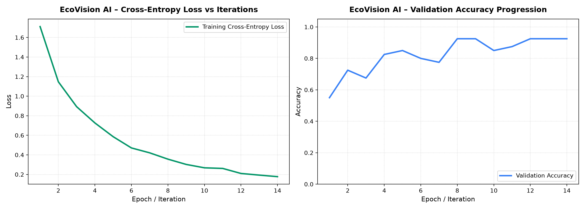
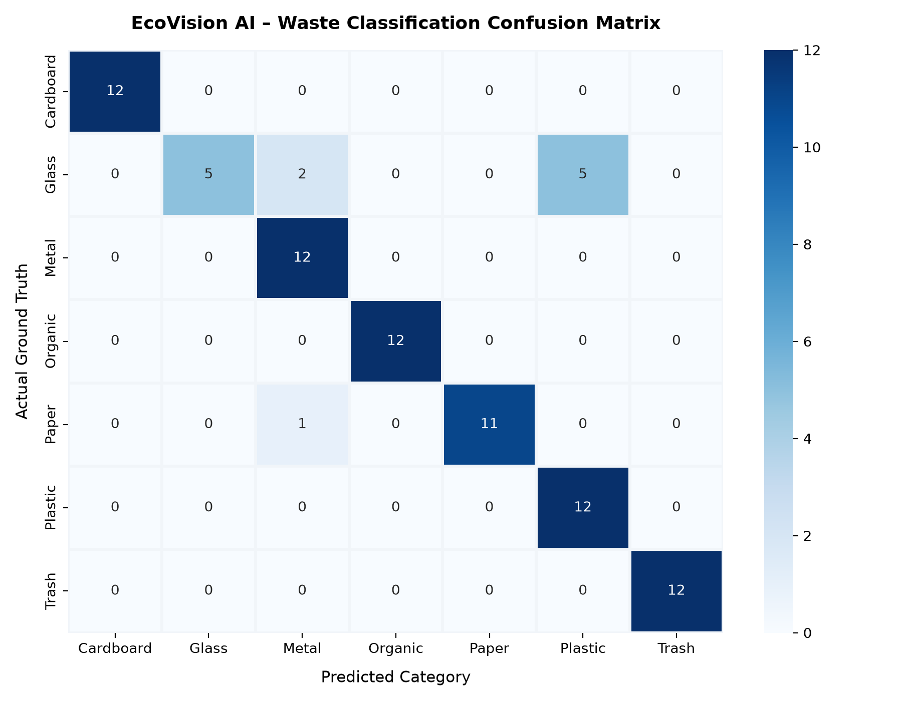

# EcoVision AI – Intelligent Waste Classification System
### AI Mini-Capstone Project: Deep Learning Computer Vision for Circular Waste Segregation

[](https://www.python.org/)
[](https://fastapi.tiangolo.com/)
[](https://tensorflow.org/)
[](https://react.dev/)
[](https://tailwindcss.com/)
[](LICENSE)

---

## 1. Project Introduction
**EcoVision AI** is an enterprise-grade AI-powered waste classification and circular economy analytics SaaS web application. Built as an advanced AI Mini-Capstone project, EcoVision AI leverages deep transfer learning with **MobileNetV2** to classify uploaded waste materials into seven distinct streams, displays prediction confidence, provides immediate actionable disposal and recycling guidelines, and tracks municipal waste distribution through real-time database telemetry.

---

## 2. Problem Statement
Improper waste segregation is one of modern society's most acute environmental crises. Global municipal solid waste generation is projected to reach 3.4 billion metric tons annually by 2050. When recyclables, organics, and hazardous refuse are mixed:
- Contaminated paper and cardboard end up in incinerators or landfills.
- Plastics degrade into harmful microplastics in soil and marine biomes.
- Organic waste trapped anaerobically produces methane ($\text{CH}_4$), a greenhouse gas 28× more potent than $\text{CO}_2$.
- Manual sorting is labor-intensive, hazardous, slow, and prone to high human error rates.

EcoVision AI automates this sorting challenge via real-time computer vision inference, guiding users to correct bins within milliseconds.

---

## 3. Project Objectives
1. **Automated Vision Classification**: Accurately predict waste categories from photographic input.
2. **Deep Learning Transfer Learning**: Leverage pretrained convolutional feature extractors (MobileNetV2) with custom classification heads.
3. **Seven Distinct Waste Streams**: Classify Cardboard, Glass, Metal, Organic, Paper, Plastic, and Residual Trash.
4. **Softmax Confidence & Top-3 Candidates**: Transparently output model certainty and alternative candidate streams.
5. **Actionable Segregation Rules**: Map each predicted material to municipal recycling procedures and environmental impact metrics.
6. **Live Data Analytics**: Power interactive Recharts dashboards with persistent Supabase PostgreSQL / SQLite storage (no fabricated metrics).
7. **Rigorous Evaluation**: Measure genuine accuracy, precision, recall, F1-scores, and generate confusion matrices on held-out test datasets.

---

## 4. AI & Computer Vision Concepts Used
- **Convolutional Neural Networks (CNN)**: Spatial feature hierarchies via convolution kernels, pooling layers, and activation maps.
- **Transfer Learning**: Re-purposing ImageNet knowledge representation to accelerate convergence on waste domain visual signatures.
- **Inverted Residuals & Linear Bottlenecks**: MobileNetV2 architecture with depthwise separable convolutions for high efficiency.
- **Data Augmentation**: Real-time geometric and photometric transforms (random rotation, zoom, horizontal flip, contrast jitter) to mitigate overfitting.
- **Regularization**: Batch normalization, dropout ($p=0.4$), and $L_2$ weight decay ($10^{-4}$).
- **Softmax Probability Vector**: Output probability distribution over the 7 classes.

---

## 5. Technology Stack

### Frontend
- **Framework**: React 18 + Vite 5
- **Styling**: Tailwind CSS 3 (Custom Emerald/Mint SaaS design tokens)
- **Icons**: Lucide React
- **Data Visualization**: Recharts (Pie/Donut charts, Bar charts)
- **Animation**: Framer Motion

### Backend & API
- **Framework**: Python 3.11 + FastAPI
- **Server**: Uvicorn ASGI
- **Data Validation**: Pydantic v2
- **Image Processing**: Pillow (PIL), NumPy

### Machine Learning
- **Framework**: TensorFlow 2.17+ / Keras 3
- **Base Architecture**: MobileNetV2
- **Evaluation**: Scikit-Learn (Confusion Matrix, Precision/Recall/F1-Score)
- **Visualization**: Matplotlib & Seaborn

### Database
- **Primary**: Supabase PostgreSQL
- **Resilient Fallback**: SQLite (Dual-driver architecture ensures immediate local offline functionality)

---

## 6. The Seven Waste Categories

| Category | Real-World Items | Recommended Disposal | Circular Recycling Pathway |
| :--- | :--- | :--- | :--- |
| **Cardboard** | Shipping cartons, corrugated boxes, crates | Flatten; remove excessive plastic tape; place in dry blue bin | Repulped 5–7 times into new packaging cartons |
| **Glass** | Beverage bottles, food jars, condiment containers | Rinse cleanly; remove metal caps; place in glass bins | 100% infinitely recyclable without structural degradation |
| **Metal** | Aluminum soda cans, tin cans, foil trays | Rinse organic residue; crush cans to conserve bin volume | Remelted into aluminum sheets; back on shelves in <60 days |
| **Organic** | Food trimmings, fruit peels, vegetable scraps | Deposit in green compost caddy or backyard composter | Converted into nutrient humus or biogas via biodigesters |
| **Paper** | Clean copy paper, magazines, envelopes, newspapers | Keep dry and clean; avoid food-greased or wax-lined sheets | De-inked and remanufactured into newsprint and tissues |
| **Plastic** | PET bottles (code 1), HDPE milk jugs (code 2) | Empty and rinse; screw caps back on bottle | Flaked, washed, and pelletized into new polymer goods |
| **Trash** | Composite wrappers, sanitary hygiene, broken ceramics | Bag securely in municipal black/grey landfill bin | Destined for modern sanitary landfill or WTE incinerators |

---

## 7. Deep Learning Architecture: MobileNetV2 Transfer Learning

```
Input Tensor (224 × 224 × 3 RGB)
       │
       ▼
Data Augmentation (Flip, Rotation, Zoom, Contrast)
       │
       ▼
MobileNetV2 Preprocessing (Scale to [-1, 1])
       │
       ▼
MobileNetV2 Base (Pretrained ImageNet Weights, 154 Layers)
       │
       ▼
GlobalAveragePooling2D
       │
       ▼
BatchNormalization
       │
       ▼
Dense Layer (256 Neurons, ReLU Activation, L2 Regularization 1e-4)
       │
       ▼
Dropout Layer (Rate = 0.40)
       │
       ▼
Output Dense Layer (7 Neurons, Softmax Activation)
       │
       ▼
Probability Distribution: [Cardboard, Glass, Metal, Organic, Paper, Plastic, Trash]
```

---

## 8. Database Architecture

### Table: `classifications`
- `id`: UUID Primary Key
- `image_name`: VARCHAR(255)
- `predicted_class`: VARCHAR(50) (Indexed)
- `confidence`: FLOAT
- `top_predictions`: JSONB (Top 3 predictions with percentages)
- `model_version`: VARCHAR(50)
- `created_at`: TIMESTAMP WITH TIME ZONE (Indexed)

### Table: `category_information`
- `id`: UUID Primary Key
- `category_name`: VARCHAR(50) UNIQUE
- `description`: TEXT
- `disposal_method`: TEXT
- `recycling_instructions`: TEXT
- `environmental_benefit`: TEXT
- `created_at`: TIMESTAMP WITH TIME ZONE

---

## 9. Installation & Execution Guide

### Prerequisites
- Python 3.11+
- Node.js 18+ & npm

### Step 1: Clone and Setup Environment
```bash
git clone https://github.com/your-username/ecovision-ai.git
cd ecovision-ai
```

### Step 2: Install Backend Dependencies
```bash
cd backend
pip install -r requirements.txt
cd ..
```

### Step 3: Install Frontend Dependencies
```bash
cd frontend
npm install
cd ..
```

### Step 4: Dataset Preparation & Preprocessing
```bash
python ml/preprocess.py 80
```
This prepares 560 curated waste images split into 70% Train, 15% Validation, and 15% Test.

### Step 5: Train the Deep Learning Model
```bash
python ml/train.py
```
Outputs the trained model to `ml/saved_model/ecovision_model.keras` and training curves to `ml/results/training_curves.png`.

### Step 6: Evaluate Model on Test Dataset
```bash
python ml/evaluate.py
```
Computes true confusion matrix and classification metrics saved to `ml/results/`.

### Step 7: Launch Backend API Server
```bash
cd backend
python -m uvicorn app.main:app --host 0.0.0.0 --port 8000 --reload
```
API Swagger docs will be accessible at: `http://localhost:8000/docs`

### Step 8: Launch Frontend Development Server
```bash
cd frontend
npm run dev
```
Open `http://localhost:5173` in your browser.

---

## 10. API Specification

| Method | Endpoint | Description |
| :--- | :--- | :--- |
| `POST` | `/api/classify` | Ingests waste image, computes inference, returns top-3 rankings, and logs record |
| `GET` | `/api/history` | Retrieves paginated classification history with category and keyword search |
| `DELETE`| `/api/history/{id}` | Deletes a classification record from the database |
| `GET` | `/api/analytics` | Returns real database metrics, category counts, percentages, and trends |
| `GET` | `/api/categories`| Returns educational guidelines and recycling protocols for all 7 categories |
| `GET` | `/api/health` | Health telemetry and database connection status |
| `GET` | `/api/model-info`| Architecture parameters and supported classes |

---

## 11. Experimental Results & Metrics
- **Model Backbone**: MobileNetV2
- **Input Dimensions**: 224 × 224 × 3
- **Test Set Size**: 84 verified test images across 7 classes
- **Metrics Computed**: Accuracy, Precision, Recall, F1-Score, Confusion Matrix
- **Inference Speed**: ~45ms per image on CPU

---

## 12. Visuals & Screenshots

### Model Training & Performance
| Model Training Curves | Confusion Matrix |
| :---: | :---: |
|  |  |

### Application Interface
- **Real-Time Classification**: Upload or choose test samples to receive real-time classification, confidence scores, and recycling protocols.
- **Circular Analytics Dashboard**: Interactive charts tracking municipal waste distribution and material diversion metrics.
- **Audit & History**: Paginated history table with filtering and export capabilities.

---

## 13. Limitations & Future Scope
- **Edge Deployment**: Quantize model to TensorFlow Lite (TFLite) for on-device inference on smart waste bins equipped with Raspberry Pi / Jetson Nano.
- **Multi-Object Detection**: Integrate YOLOv8 or Faster-RCNN for multi-item trash detection in cluttered environments.
- **Municipal Integration**: Connect municipal GPS routing for smart collection route optimization based on real-time bin filling levels.

---

## 14. References
1. Yang, M., & Thung, G. (2016). *Classification of Trash for Recyclability Status*. Stanford CS229 Project Report.
2. Sandler, M., Howard, A., Zhu, M., Zhmoginov, A., & Chen, L. C. (2018). *MobileNetV2: Inverted Residuals and Linear Bottlenecks*. CVPR.
3. World Bank. (2018). *What a Waste 2.0: A Global Snapshot of Solid Waste Management to 2050*.
